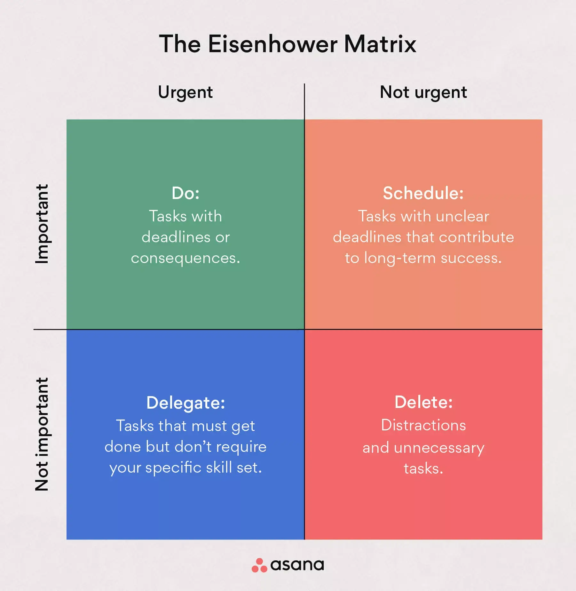
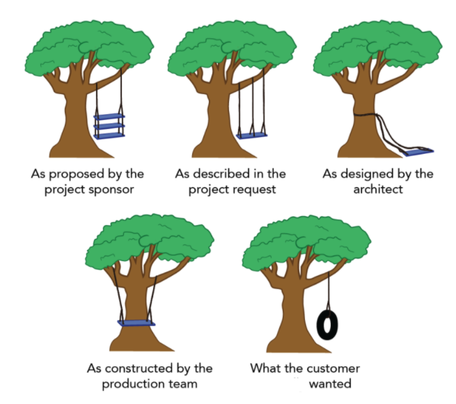
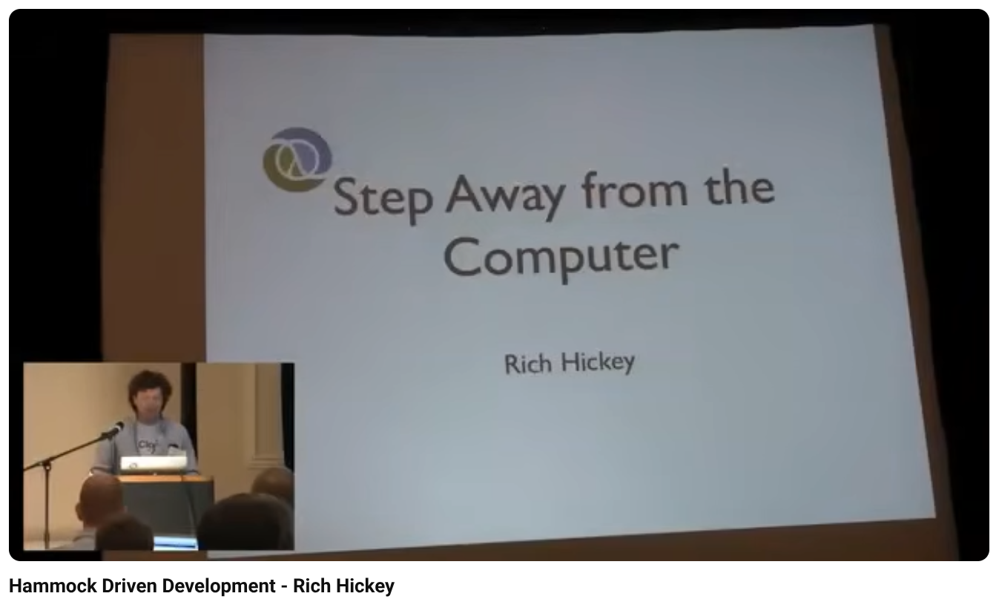
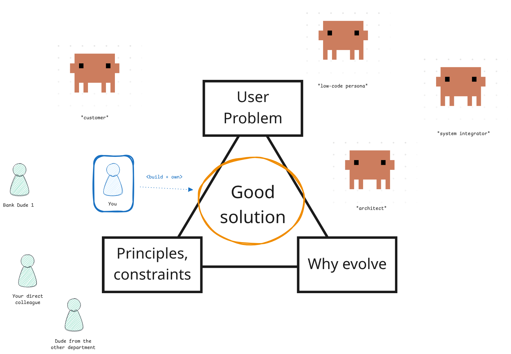

# Working with *Robots*

<small>[`Nico Rehwaldt`](https://github.com/nikku) 2026</small>

---

## My background

As a [principal engineer at Camunda](https://docs.google.com/presentation/d/1O-uH4xKSaebI84v_l-xiIumxmBQVsv7uTBpKD1k8MiY/edit?slide=id.g20f80ec8108_0_17#slide=id.g20f80ec8108_0_17) I align with folks in the product organization and evolve our core platform. I solve complex problems. I rarely solved the easy ones, even before :robot:

---

<!--config
theme=funky
-->

## Today

---

### *Computers beat humans at computing things*. It is not even close.

---

### LLMs give computers "human like" perception, accessible to everyone, in human language.

---

### AI agents combine this into a powerful system of memory, "understanding" and execution.

---

<!--config
theme=funky
-->

## Robots / Agentic AI accelerates

---

---

## Our job is to ensure the computer does not do :poop:, at scale.

---

<!--config
theme=funky
-->

## What remains Human (for now)?

---

### *We are responsible*—today, and in the future.

---

### We set goals and priorities - What to do, why, when?

---

---

#### Just because it is cheap, does not mean it requires my attention.

---

### We own the outcome - how does a good result look like?

---

---

### We own the trade-offs.

---

---

### We shape the environment so co-workers and agents can do their best work.

---

#### We decide on context, we decide on guard rails.

#### Looking at "what :robot: does, why" is helpful, to understand what it is missing.

---

<!--config
theme=funky
-->

## Common misconceptions

---

### Building is cheap

---

### Building is cheap, judgement is not

---

### Building is cheap, ownership is not

---

### Not building something may be even cheaper

---

#### "The best line of code is the one you never wrote."

---

### *80/20* - Value version

#### Solve the 80% with 20% of original scope. What are the essential 20%? What do we truely need?

---

### Alignment and consolidation are not cheap.

---

#### Cleanup, platform work, all remain hard problems.

---

### Detecting critical (software, organizational, design) bugs, you better do it early.

---

### Learn from your mistakes, you better do it always.

---

### Detect fuzzieness, where it matters

---

#### Robots, like humans, will be overconfident at times.

#### Primed to convince and please yourself (or your co-workers) - check each other.

---

<!--config
theme=funky
-->

## To tackle complex problems, we need deep comprehension and focus

---

---

### Robots are amazing, but they remain *System 1*

---

### Comprehension requires *attention*

---

---

### Comprehension requires *exchange*

---

---

### (Human) Comprehension requires *idling*

---

---

<!--config
theme=funky
-->

## Robots support + accelerate, they do not replace good practices

---

---

## Thanks

# :heart: